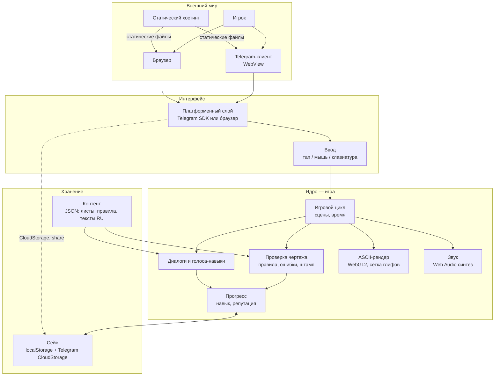
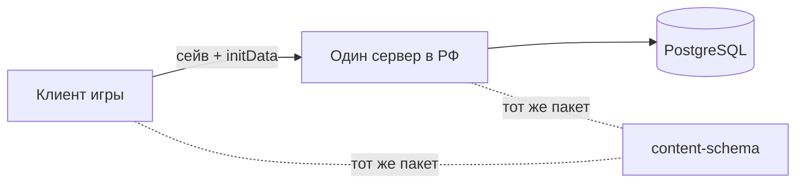

# Карта системы

Статусы: ✅ реализовано · 🔜 запланировано · 💡 гипотеза. Пока кода нет — всё 🔜/💡.

## Шаги 0–1 (демо и MVP): только клиент, без сервера



## Слои, зависимости, координаты
Ответ на [риски 1, 3, 8, 9](../07-нефункциональные/риски-архитектуры.md).

### Пакеты и разрешённые зависимости
```
packages/
  content-schema/   типы контента и сейва, валидатор, слияние и миграции сейва, condition-движок  (чистый TS, без DOM)
  game/
    core/           сцены, механика листа, диалоги, прогресс, PRNG, время         → импортирует только content-schema
    layout/         экран → вьюпорт → сетка, перенос слов, screenToCell             → content-schema
    render/         Renderer: буфер ячеек → WebGL2 | Canvas2D                       → layout
    audio/          Audio: автомат состояний + синтез                               → —
    platform/       Platform: browser | telegram | fake                             → —
    app/            сборка всего вместе, порядок старта                             → всё
  server/ (шаг 2)   → content-schema
```
**Правило:** `core` не импортирует `render`, `audio`, `platform`, `window`, `document`, `Math.random`, `Date.now`. Проверяется линтером в CI ([тестирование](../07-нефункциональные/тестирование.md)). Ядро общается с внешним миром только через интерфейсы ниже, которые ему передаёт `app`.

### Интерфейсы
| Интерфейс | Методы | Реализации |
|---|---|---|
| `Platform` | `start()` → параметры запуска (startParam, perfClass?); `lifecycle(onPause, onResume)`; `storage` → `SaveStore`-адаптер; `share(payload)`; `viewport(onChange)` → размер, safe area | `browser`, `telegram`, `fake` (тесты) |
| `SaveStore` | `load(): Promise<Save>`, `save(Save): Promise<void>` — асинхронный с первого дня | `Local`, `Cloud` (Telegram), `Remote` (заглушка до шага 2) |
| `Renderer` | `draw(CellBuffer)`, `resize(grid)`, `onContextLost/Restored` | `WebGL2`, `Canvas2D` — общий набор тестов «один буфер → один вывод» |
| `Audio` | `unlock()` по жесту, `pause()`, `play(sfx)`, `state` (`locked/running/suspended/interrupted`) | `WebAudio` (без AudioContext остаётся в `locked` = беззвучно; отдельная `Silent`-реализация не нужна) |

### Системы координат
`пиксели экрана` → **вьюпорт** (окно на лист, пан/зум) → **сетка** (клетки экрана) → **клетки рисунка** (клетки листа).
- Размер клетки — **целое число физических пикселей** из фиксированного набора (напр. 8×14, 10×18, 12×22 px); минимальный выбран по тесту читаемости кириллицы. Дробного масштаба нет.
- Лист **не ужимается** под экран: он больше экрана и показывается окном с панорамой (перетаскивание) и 2–3 ступенями зума.
- Перевод тапа — одна чистая функция `screenToCell(point, viewport) → cell`, покрыта тестами.
- Офис (комната) рисуется той же сеткой, но с камерой, следующей за персонажем.

### Сцены
Конечный автомат со стеком: `boot → office ⇄ sheet`, поверх любой — `cutscene`, `pause`. Событие не прерывает лист посередине: ставится в очередь и стартует после штампа ([запустить-событие](../02-ядро/способности/запустить-событие.md)).

### Порядок старта
Подробно, со сбоями на каждом шаге — [триггеры](../04-потоки/триггеры.md).
`platform.start()` (дождаться SDK, если Telegram) → `saveStore.load()` → загрузка и проверка контента → `scene = boot` → первый тап разблокирует звук. Без гонок: каждый шаг ждёт предыдущий.

## Шаг 2 (первая глава): швы, не план 💡
Сервер **вычеркнут из активной архитектуры** до прохождения гейта холодной аудитории ([вердикт премортема](../../idea/07-risks/README.md)). Сейчас фиксируются только швы, чтобы шаг 2 не пришлось «приделывать сбоку»:
- общий пакет `content-schema` — сервер проверяет прогресс тем же кодом, что и клиент;
- асинхронный `SaveStore` с адаптером `Remote`;
- `playerId` — анонимный id устройства с шага 1, привязка к Telegram позже;
- контракт API на одну страницу — пишется перед шагом 2; решение «запасной вход» — тоже перед шагом 2 ([безопасность](../07-нефункциональные/безопасность.md)).



## Компоненты

| Компонент | Что делает |
|---|---|
| Платформенный слой | Единственное место, которое знает, где запущена игра; интерфейс `Platform` выше. В Telegram — SDK (viewport, safe area, `disableVerticalSwipes`, CloudStorage, share, `performance_class`). В браузере — заглушки. Ядро про Telegram не знает. ← [принцип 6](../../idea/06-principles/README.md) |
| Игровой цикл | Автомат сцен со стеком (выше); время — только накопленный `dt`, не больше 100 мс за кадр; пауза — событие платформы, не часы. |
| Проверка чертежа | Ядро механики: лист + набор активных правил → список ошибок; игрок тапает → засчитано/нет; штамп. Детерминировано: единственный источник случайности — сеяный PRNG (зерно = hash(sheetId, attempt, saveSeed)). ← [принцип 2](../../idea/06-principles/README.md) |
| Диалоги и голоса | Реплики ГАПа, ИИ-стажёра, голосов-навыков; лимит «слушаний» на лист. |
| Прогресс | 1 навык + 1 репутация (MVP). |
| ASCII-рендер | Получает от ядра буфер ячеек (символ + цвет), рисует одним draw call (WebGL2 instanced + атлас) или Canvas2D. Переживает потерю контекста. Качество — по собственному замеру кадра, `performance_class` Telegram — только подсказка. ← [методики](../../idea/05-research/methodologies.md) |
| Звук | Процедурный 8-бит: штамп, плоттер, тиканье, «бормотание». Автомат состояний `locked → running → suspended/interrupted`; игра полностью играбельна без звука, индикатор «звук выкл» всегда виден. |
| Контент | Листы, правила, тексты — данные, не код. Русский; ключи под будущий EN. |
| Сейв | Асинхронный `SaveStore`; localStorage + дубль в CloudStorage в Telegram; копии **сливаются**, а не перезаписываются ([сущности](../03-данные/сущности.md)). ← [local-first](../../idea/06-principles/local-first.md) |

## UX-стиль
**Визуальный интерфейс**: свой UI, ASCII-анимации, звук, тактильный отклик (haptic в Telegram). Не «тихий бэкенд».

## Связи
[ядро и способности](../02-ядро/характер.md) · [данные](../03-данные/сущности.md) · [триггеры](../04-потоки/триггеры.md) · [стек](../05-стек/технологии.md) · [риски](../07-нефункциональные/риски-архитектуры.md) · [roadmap](../08-дорожная-карта/roadmap.md)
