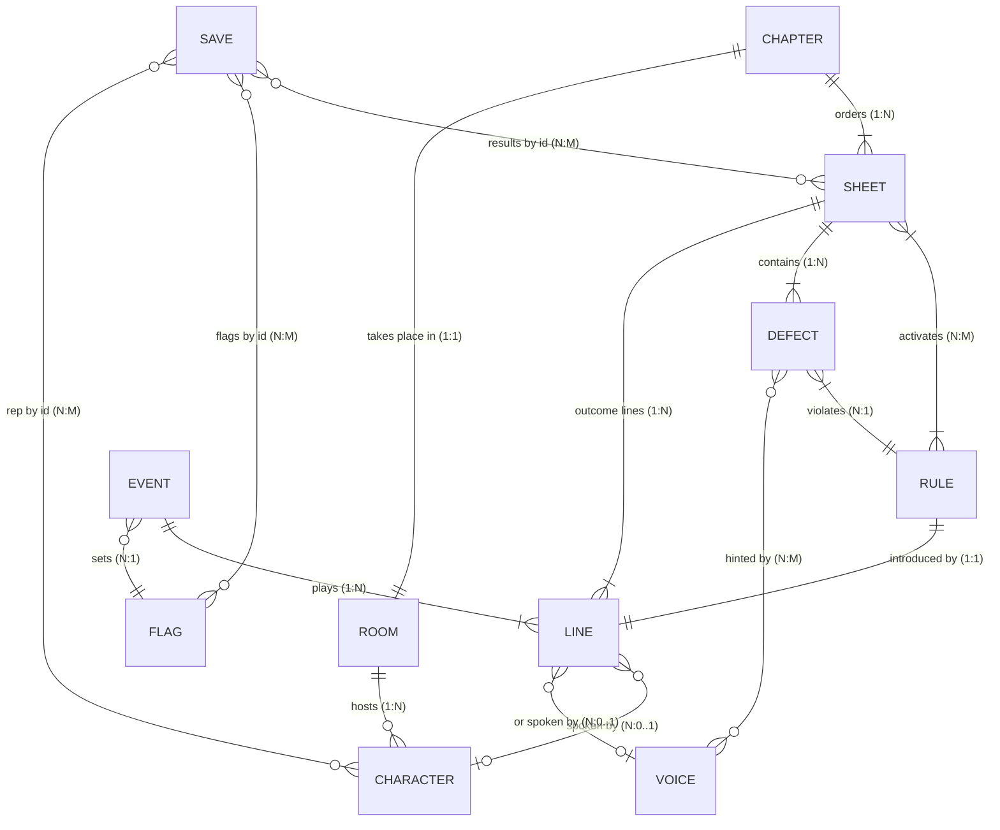

# Схема связей

## Какая сторона хранится
| Связь | Хранится | Вычисляется при загрузке |
|---|---|---|
| лист ↔ глава | `chapter.sheets[]` (порядок важен) | глава листа |
| ошибка ↔ лист | `defect.sheet` | список ошибок листа |
| ошибка ↔ область | символ в `.mask.txt` + `defect.mark` | `defect.area`, центр |
| правило ↔ лист | `sheet.rules[]` | `rule.firstSheet` |
| персонаж ↔ комната | `character.room` + `pos` | список персонажей комнаты |
| событие ↔ флаг | `event.flag` | — |

Сейв ссылается на контент только строковыми `id` — это логические связи, не внешние ключи БД (на шагах 0–1 базы нет). Переименования — через `renames.json` ([нерушимые правила](правила-нерушимые.md)).
